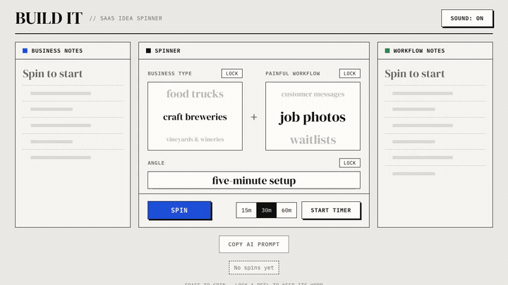
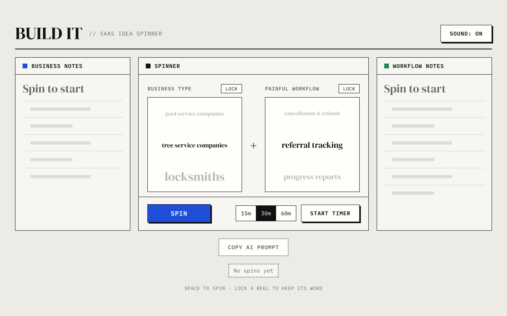
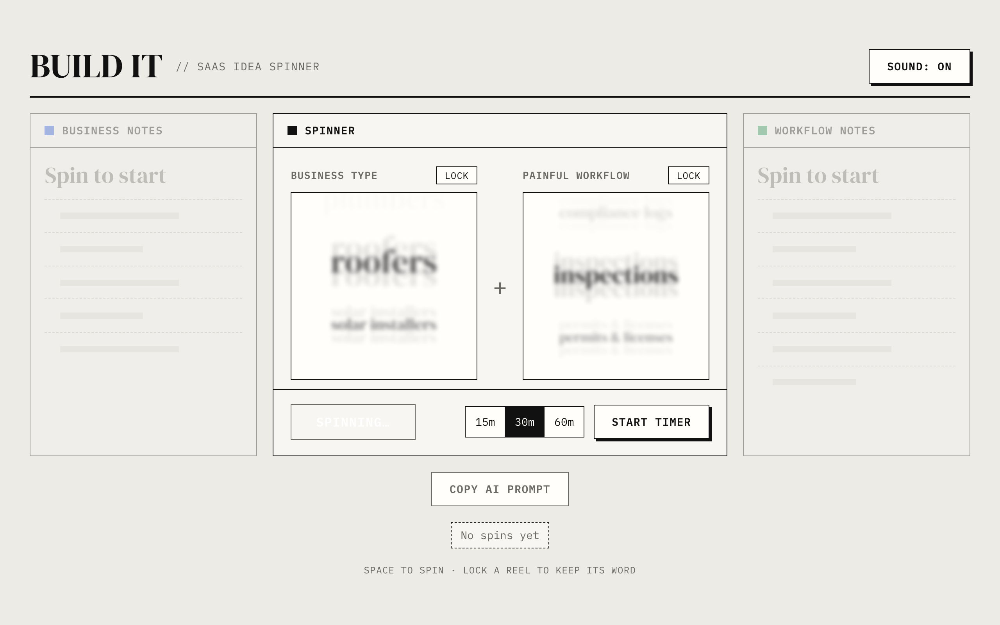
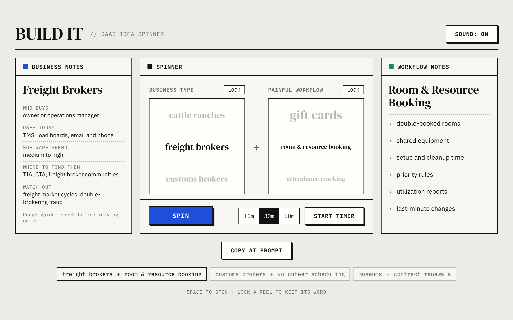
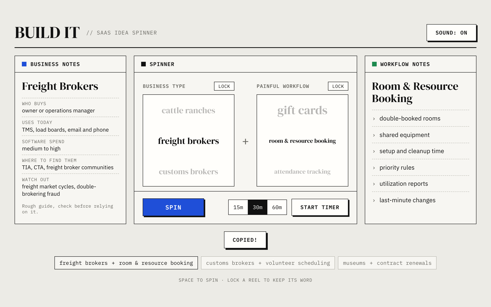
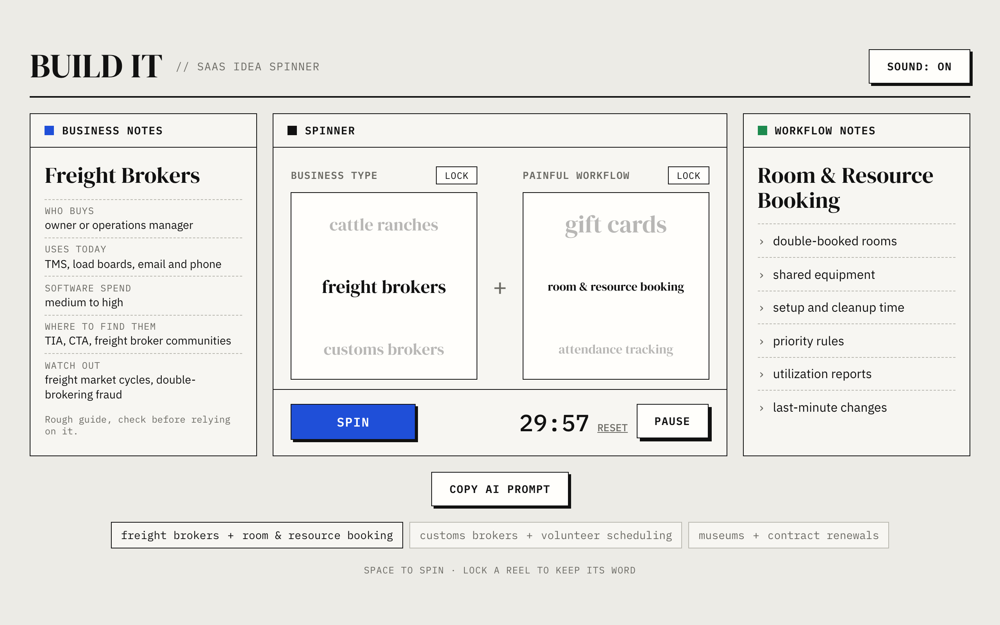
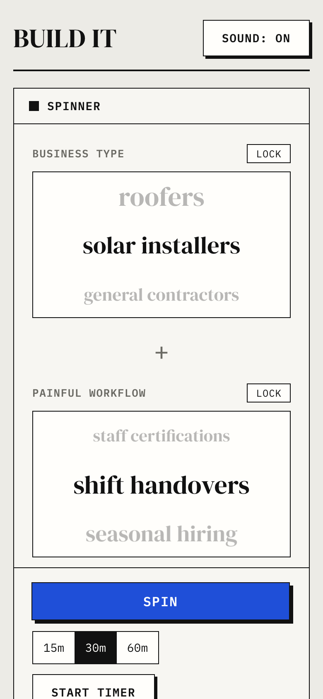

# Build It

A slot-machine style SaaS idea generator. Spin two reels, **Business type** + **Painful workflow**, then check whether businesses would actually pay for it. The lists focus on small and medium businesses in the US and Canada.



> Full-quality recording: [docs/demo.mp4](docs/demo.mp4)

## Running it

You need [Node.js](https://nodejs.org) 18 or newer.

```bash
# 1. Install dependencies (first time only)
npm install

# 2. Start the dev server
npm run dev
```

Then open **http://localhost:5173** in your browser.

To make a production build:

```bash
npm run build     # outputs to dist/
npm run preview   # serves the built app at http://localhost:4173
```

## How to use it

| | |
|---|---|
| **Spin** | Click **Spin** or press **Space**. Both reels spin, and the workflow reel stops a little after the business reel. |
| **Read the notes** | The left panel shows rough facts about the business (who buys, what they use today, software spend, where to find them, what to watch out for). The right panel lists common problems with the workflow. |
| **Lock a reel** | Click **Lock** next to a reel's label to keep its word. Spin again to change only the other reel. |
| **Check it with AI** | After a spin, click **Copy AI prompt**. It copies a prompt with the spin and its notes that asks an AI to judge the idea as a SaaS for the US and Canada: customer, market size, pricing, competitors, the angles that would make it win, first 10 customers, interview questions and risks. Paste it into any AI chat. |
| **Timer** | Pick 15, 30 or 60 min and click **Start timer**. You can pause, resume or reset it. |
| **History** | Your last 6 combinations appear as tags under the controls. |

## Screenshots

**Ready to spin**



**Mid-spin (motion blur)**



**A result, with history**



**AI prompt copied**



**Timer running**



**On a phone**



## Customizing the words

Edit [`src/words.js`](src/words.js). `BUSINESS_FACTS` holds each business type and its notes, and `WORKFLOW_ASPECTS` holds each workflow and its problems. Add or remove as many as you like.

## Project layout

```
src/
  App.jsx      page layout, spin logic, timer, history
  Reel.jsx     a single spinning reel with motion blur
  words.js     business types, workflows and their notes
  styles.css   styling
docs/          screenshots and demo recordings
```
